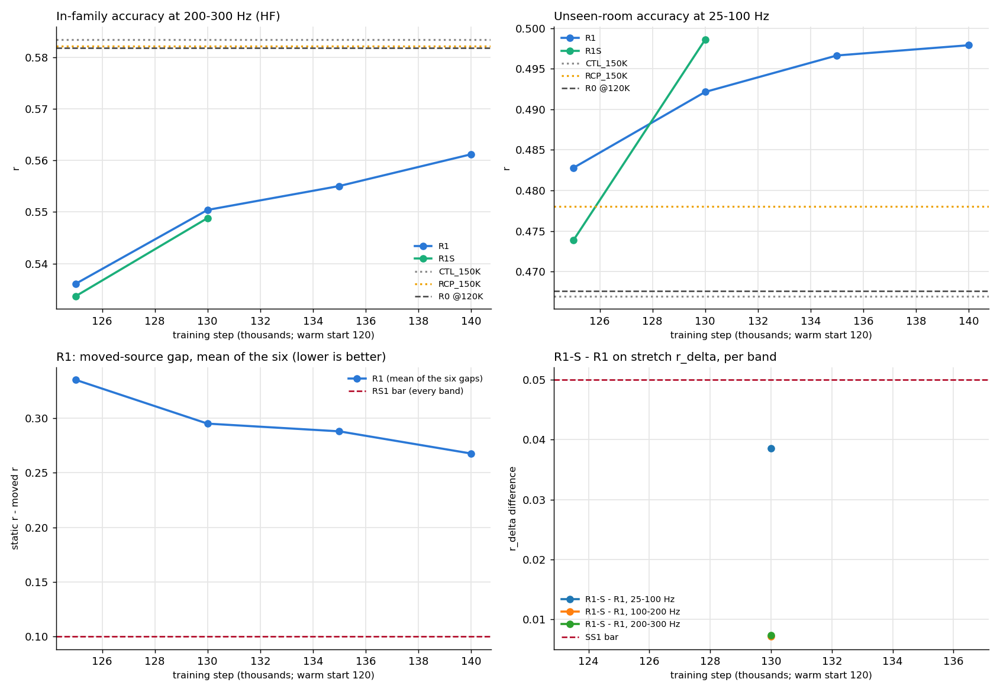

# P4-10 progress board

Built 2026-11-23 19:56 (from JSON on disk; every read is a scored checkpoint).

**Next reads (from each arm's training log):** R1: step 143800 at 0.78 s/step, next read 145000 at about 20:12 ET (posted within 1 h of it); R1M: step 123400 at 0.81 s/step, next read 125000 at about 20:18 ET (posted within 1 h of it); R1S: step 138000 at 0.82 s/step, next read 140000 at about 20:24 ET (posted within 1 h of it)

**Running jobs:** aaf_speckle_an x1, aaf_backstop x1, aaf_r1 x1, aaf_r1s x1, aaf_r1m x1

## R1 -- in-family moved-source gap, band mean, second and third source (bar: each band <= 0.10)

| read | HF (test 200-300) | UF 25-100 / 100-200 / 200-300 | delta HF vs ref [CI] | delta UF 25-100 [CI] |
|---|---|---|---|---|
| R1_125K | 0.536 | 0.483 / 0.393 / 0.377 | -0.047 [-0.054, -0.041] | +0.016 [+0.003, +0.028] |
| R1_130K | 0.550 | 0.492 / 0.398 / 0.393 | -0.033 [-0.039, -0.027] | +0.025 [+0.011, +0.040] |
| R1_135K | 0.555 | 0.497 / 0.412 / 0.398 | -0.028 [-0.035, -0.022] | +0.030 [+0.018, +0.043] |
| R1_140K | 0.561 | 0.498 / 0.407 / 0.393 | -0.022 [-0.029, -0.016] | +0.031 [+0.018, +0.044] |

Moved-source gap = static r on the original room - r at the moved source (in-family lite rooms; lower is better). Bar: <= 0.10 in every band.

| read | source | 25-100 | 100-200 | 200-300 |
|---|---|---|---|---|
| R1_125K | second | 0.351 [0.252, 0.458] | 0.405 [0.349, 0.461] | 0.378 [0.349, 0.417] |
| R1_125K | third | 0.243 [0.199, 0.284] | 0.305 [0.274, 0.334] | 0.328 [0.307, 0.346] |
| R1_130K | second | 0.312 [0.213, 0.418] | 0.390 [0.321, 0.461] | 0.347 [0.321, 0.383] |
| R1_130K | third | 0.187 [0.151, 0.220] | 0.264 [0.235, 0.289] | 0.269 [0.254, 0.285] |
| R1_135K | second | 0.284 [0.191, 0.387] | 0.394 [0.329, 0.461] | 0.372 [0.329, 0.426] |
| R1_135K | third | 0.156 [0.125, 0.180] | 0.253 [0.218, 0.284] | 0.269 [0.250, 0.290] |
| R1_140K | second | 0.236 [0.164, 0.316] | 0.391 [0.310, 0.471] | 0.366 [0.329, 0.414] |
| R1_140K | third | 0.133 [0.103, 0.160] | 0.231 [0.194, 0.264] | 0.249 [0.232, 0.267] |

## R1M -- EDT decay-rate edit slope on Material (lite) cells, MM1 (D201/D202; bar: slope in [0.8, 1.2], Pearson >= 0.8)

| read | HF (test 200-300) | UF 25-100 / 100-200 / 200-300 | delta HF vs ref [CI] | delta UF 25-100 [CI] |
|---|---|---|---|---|

## R1S -- r_delta on Stretch (lite) cells, in-family, paired vs R1 at the same step (bar: +0.05, CI > 0, >= 2 of 3 bands)

| read | HF (test 200-300) | UF 25-100 / 100-200 / 200-300 | delta HF vs ref [CI] | delta UF 25-100 [CI] |
|---|---|---|---|---|
| R1S_125K | 0.534 | 0.474 / 0.396 / 0.391 | -0.002 [-0.009, +0.005] | -0.009 [-0.016, -0.002] |
| R1S_130K | 0.549 | 0.499 / 0.413 / 0.395 | -0.002 [-0.006, +0.002] | +0.006 [+0.001, +0.012] |
| R1S_135K | pending | | | |

Stretch r_delta (lite cells; paired vs R1 at the same step):

| read | set | level | R1 | delta 25-100 / 100-200 / 200-300 [CI] |
|---|---|---|---|---|
| R1S_130K | test | 0.801 / 0.539 / 0.341 | 0.762 / 0.532 / 0.333 | +0.039 [+0.015, +0.066] / +0.007 [+0.001, +0.012] / +0.007 [+0.002, +0.013] |
| R1S_130K | unseen | 0.362 / 0.290 / 0.225 | 0.338 / 0.266 / 0.211 | +0.025 [+0.014, +0.036] / +0.024 [+0.018, +0.031] / +0.014 [+0.005, +0.022] |

Moved-source gap = static r on the original room - r at the moved source (in-family lite rooms; lower is better). Bar: <= 0.10 in every band.

| read | source | 25-100 | 100-200 | 200-300 |
|---|---|---|---|---|
| R1S_130K | second | 0.303 [0.221, 0.390] | 0.396 [0.328, 0.465] | 0.367 [0.338, 0.405] |
| R1S_130K | third | 0.167 [0.145, 0.188] | 0.246 [0.209, 0.275] | 0.266 [0.251, 0.284] |

## Table C -- latest read per model, in-family lite rooms: edited r / r_delta (25-100 / 100-200 / 200-300 Hz)

| family | model | n rooms | edited r | r_delta |
|---|---|---|---|---|
| StretchU | R1_140K | 8 | 0.758 / 0.524 / 0.407 | 0.804 / 0.570 / 0.383 |
| StretchU | R1S_130K | 8 | 0.798 / 0.549 / 0.447 | 0.830 / 0.574 / 0.388 |
| StretchU | R0_120K | 8 | 0.761 / 0.532 / 0.417 | 0.816 / 0.588 / 0.405 |
| StretchA | R1_140K | 8 | 0.817 / 0.584 / 0.481 | 0.738 / 0.507 / 0.304 |
| StretchA | R1S_130K | 8 | 0.856 / 0.587 / 0.498 | 0.771 / 0.504 / 0.293 |
| StretchA | R0_120K | 8 | 0.819 / 0.595 / 0.488 | 0.756 / 0.530 / 0.323 |
| Wall | R1_140K | 8 | 0.895 / 0.639 / 0.544 | 0.715 / 0.462 / 0.427 |
| Wall | R1S_130K | 8 | 0.884 / 0.618 / 0.532 | 0.705 / 0.444 / 0.414 |
| Wall | R0_120K | 8 | 0.909 / 0.655 / 0.555 | 0.748 / 0.485 / 0.448 |
| Notch | R1_140K | 8 | 0.899 / 0.656 / 0.543 | 0.565 / 0.279 / 0.171 |
| Notch | R1S_130K | 8 | 0.892 / 0.640 / 0.530 | 0.551 / 0.266 / 0.162 |
| Notch | R0_120K | 8 | 0.914 / 0.678 / 0.559 | 0.588 / 0.299 / 0.188 |
| Source | R1_140K | 8 | 0.720 / 0.352 / 0.250 | 0.758 / 0.493 / 0.386 |
| Source | R1S_130K | 8 | 0.664 / 0.328 / 0.230 | 0.721 / 0.480 / 0.379 |
| Source | R0_120K | 8 | 0.229 / 0.074 / 0.034 | 0.497 / 0.380 / 0.297 |
| Material | R1_140K | 8 | 0.686 / 0.509 / 0.435 | 0.131 / 0.027 / -0.000 |
| Material | R1S_130K | 8 | 0.693 / 0.492 / 0.417 | 0.136 / 0.019 / 0.000 |
| Material | R0_120K | 8 | 0.719 / 0.518 / 0.407 | 0.101 / 0.032 / 0.008 |

